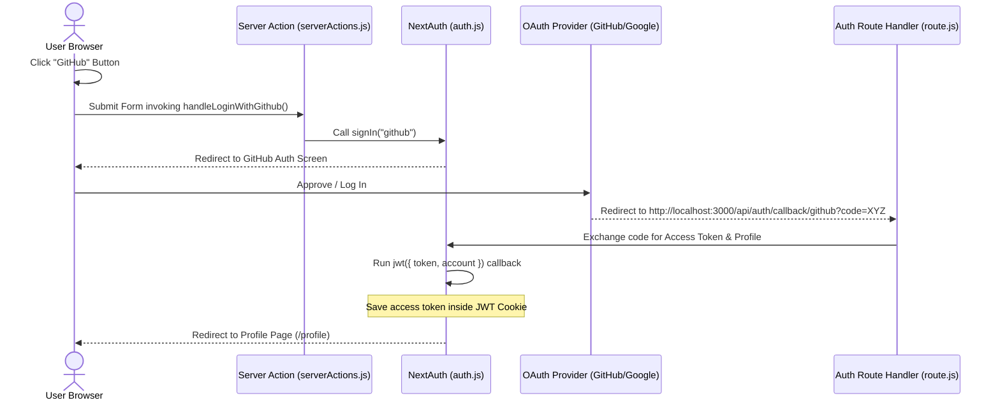
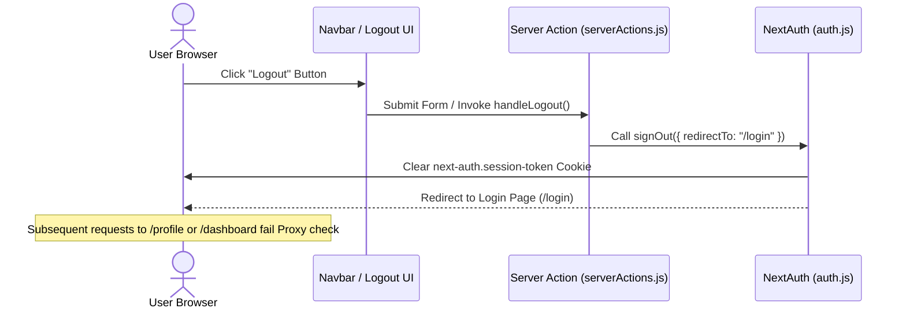

# Complete NextAuth.js (Auth.js v5) Authentication Flow Guide

This document explains the **A-Z flow** of your Next.js authentication system, addresses the browser security warnings you are seeing, details how login information is saved, and guides you on next steps to make this project production-ready.

---

## 1. Browser Security Warnings Explained

When testing your login flow locally, you might see one or more security warnings in your browser (e.g., Chrome or Firefox).

### Warning A: "The form you are submitting is not secure" / "Insecure Redirect"
* **Why it happens:** External OAuth providers (like Google and GitHub) run on secure `https://` protocols. When you click **Login with Google** or **GitHub**, your app redirects you to their secure login pages. After successful authentication, they redirect you back to your local development server, which runs on insecure `http://localhost:3000`. Chrome detects a navigation from a secure (`https`) origin to an insecure (`http`) origin and displays a mixed-content/form-security warning.
* **How to fix/ignore:**
  * **In Local Development:** You can safely ignore this warning by clicking "Submit anyway" or "Proceed". It is a standard safety feature for developers.
  * **In Production:** This warning will **automatically disappear** because your production site will run entirely on secure HTTPS (e.g., Vercel automatically configures SSL/TLS certificates).
  * **To fix locally (Optional):** You can set up a local HTTPS proxy or use tools like `next dev --experimental-https` to run your local server on HTTPS.

### Warning B: "SameSite / Secure Cookie Warning" in DevTools Console
* **Why it happens:** NextAuth uses cookies to track sessions. On `https`, NextAuth secures cookies by marking them `Secure` and setting `SameSite=Lax` or `SameSite=None`. On `http://localhost`, browsers do not allow the `Secure` flag for standard HTTP cookies (except localhost bypasses in some browsers). NextAuth automatically downgrades the cookies to non-secure names (e.g., `next-auth.session-token` instead of `__Secure-next-auth.session-token`) so they work locally, but the browser console still alerts you that these cookies lack the secure flags needed for modern production standards.
* **How to fix:** It is handled automatically. NextAuth detects your environment; when you deploy to production on an `https://` domain, it automatically upgrades cookies to be fully secure, resolving the console warning.

---

## 2. A-Z Flow of Your Authentication Code

Here is exactly what happens behind the scenes from the moment a user clicks a login button:

### The Flow Diagram



### Step-by-Step Breakdown:
1. **User action:** The user is on the login page (`/login`) and clicks the **GitHub** button.
2. **Server Action execution:** The button is inside a `<form>` element whose `action` attribute is set to `handleLoginWithGithub` (in [serverActions.js](file:///home/bipinn/Desktop/nextjsLearning/NextjsPractice/Shadcn-pnpm-next-Tailwind-StarterKit/app/actions/serverActions.js)).
3. **Triggering SignIn:** The Server Action calls `signIn("github")` from [auth.js](file:///home/bipinn/Desktop/nextjsLearning/NextjsPractice/Shadcn-pnpm-next-Tailwind-StarterKit/auth/auth.js).
4. **OAuth Redirect:** NextAuth automatically prepares the OAuth request and redirects the user's browser to GitHub's authorization page.
5. **Authorization:** The user logs in to GitHub and authorizes your application.
6. **The Callback Endpoint:** GitHub redirects the user back to your app's callback URL: `/api/auth/callback/github` with a temporary authorization code.
7. **Route Handler:** The catch-all route handler in [route.js](file:///home/bipinn/Desktop/nextjsLearning/NextjsPractice/Shadcn-pnpm-next-Tailwind-StarterKit/app/api/%5B...nextauth%5D/route.js) intercepts this request and passes it to NextAuth's `handlers`.
8. **Token Exchange:** NextAuth sends the temporary code back to GitHub in exchange for an **access token** and the **user's profile information** (name, email, avatar).
9. **JWT Callback Execution:** NextAuth triggers the `jwt` callback in `auth.js`, allowing you to append custom details (like the provider access token) to the JSON Web Token.
10. **Cookie Storage:** NextAuth encrypts the JWT and saves it as a secure cookie in the user's browser.
11. **Page Redirect:** The user is logged in and redirected back to your application (e.g., to `/profile` as specified by Google sign-in or a default page).

---

## 3. How It Saves Your Login Info

NextAuth.js uses a **stateless, client-side session architecture** by default:

1. **JSON Web Token (JWT):** When authentication succeeds, the user's profile and authentication metadata are packed into a JSON Web Token.
2. **JWE (JSON Web Encryption):** To protect this data, NextAuth encrypts the JWT using a key derived from your `AUTH_SECRET` environment variable. The client (browser) cannot read or alter this token; only your Next.js server can decrypt it.
3. **HttpOnly Cookies:** The encrypted JWT is sent to the browser and stored in an `HttpOnly` cookie named `next-auth.session-token`.
   * **HttpOnly:** This prevents client-side JavaScript (including malicious scripts or XSS attacks) from reading the cookie.
   * **SameSite=Lax:** Prevents the cookie from being sent on cross-site requests, mitigating Cross-Site Request Forgery (CSRF) attacks.
4. **Retrieving Session:** Whenever the user visits a page (like `/profile`), the server reads the cookie, decrypts it using the `AUTH_SECRET`, verifies its expiration, and provides the session data to your page component using `auth()`.

---

## 4. Understanding Callbacks in `auth.js`

Callbacks are asynchronous functions you can use to control what happens when an action is performed (e.g., when a user signs in, when a JWT is created, or when a session is checked).

### Your `jwt` Callback:
```javascript
async jwt({ token, account }) {
    if (account) {
        token.accessToken = account.access_token;
    }
    return token;
}
```

### Where do `token` and `account` come from?
* **`account`**: This object is only present **the very first time** the user logs in or when the JWT is initialized. It comes directly from the OAuth provider (Google or GitHub) and contains tokens, scopes, and account-related metadata (like the access token, token type, expiry, etc.).
* **`token`**: This is the decrypted JWT object stored in the browser cookie. On subsequent requests, only `token` is passed to the callback (since `account` is only received once during the login handshake).
* **What you are doing:** You are checking if this is the initial login (`if (account)`). If it is, you copy the OAuth `access_token` into the JWT `token.accessToken` so that it is persisted inside the encrypted cookie. This allows your app to make direct API calls to GitHub or Google on the user's behalf later.

### ⚠️ Critical Catch: Exposing variables to the Client Session
By default, NextAuth **does not** copy custom fields from the JWT `token` into the `session` object returned by `auth()`. 

To make `accessToken` available in your components (e.g., `const session = await auth()`), you need to add a `session` callback:

```javascript
export const { handlers, signIn, signOut, auth } = NextAuth({
    providers: [
        Google({ ... }),
        GitHub({ ... })
    ],
    callbacks: {
        async jwt({ token, account }) {
            if (account) {
                token.accessToken = account.access_token;
            }
            return token;
        },
        async session({ session, token }) {
            // Expose the custom token fields to the session
            session.accessToken = token.accessToken;
            return session;
        }
    }
});
```

---

## 5. What Else You Need to Do and Why

To transform this setup into a production-grade application, you should consider implementing the following:

### A. Add a Database Adapter (Prisma / Drizzle)
* **Why:** By default, NextAuth uses stateless JWTs. If a user logs in, they are authenticated, but you do not save their user profile, roles, or relationships in a database. If you want to associate user accounts with custom application data (e.g., posts, profile details, comments), you need to store users in a database.
* **How:** Install an adapter (like `@auth/prisma-adapter` or `@auth/drizzle-adapter`) and configure NextAuth to store users, accounts, and session tokens directly in your database (e.g., PostgreSQL or MongoDB).

### B. Add Route Protection (Proxy)
* **Why:** Right now, anybody can navigate to `/profile` or `/dashboard` by typing the URL. Although `auth()` will return `null` if they aren't logged in, they can still see the page layout.
* **How:** Create a [proxy.js](file:///home/bipinn/Desktop/nextjsLearning/NextjsPractice/Shadcn-pnpm-next-Tailwind-StarterKit/proxy.js) file in your root folder. This automatically redirects unauthenticated users back to the login page before they even render protected pages:
  ```javascript
  import { auth } from "@/auth/auth";

  export const proxy = auth((req) => {
      const isLoggedIn = !!req.auth;
      const { nextUrl } = req;

      const isProtected = ["/dashboard", "/profile"].some((path) =>
          nextUrl.pathname.startsWith(path)
      );

      if (isProtected && !isLoggedIn) {
          return Response.redirect(new URL("/login", nextUrl));
      }
  });

  export default proxy;

  export const config = {
      matcher: ["/dashboard/:path*", "/profile/:path*"]
  };
  ```

### C. Connect your custom login form (Credentials Provider)
* **Why:** You have a custom login page using a credentials form (`CommonForm` for email and password). However, NextAuth is currently only configured to use **Google** and **GitHub**. Clicking "Sign In" on your email/password form does nothing because it's not hooked up.
* **How:** Add the `Credentials` provider from `next-auth/providers/credentials` to your `providers` array in `auth.js`. This allows you to define a `authorize` function to validate email and password inputs against a database.

### D. Session Provider for Client Components
* **Why:** If you want to check if a user is logged in inside Client Components (`"use client"`), calling the server-side `auth()` will fail.
* **How:** Wrap your root layout in a `<SessionProvider>` so you can use the `useSession()` hook in any client component to read the current session state dynamically.

---

## 6. Logout Flow and Architecture

Logging out a user in NextAuth.js (Auth.js v5) revolves around clearing the session cookies on the client side and ensuring the route protection proxy rejects subsequent requests.

### Logout Sequence Diagram



### Technical Flow and Architectural Layers

1. **Client Action (Trigger)**:
   The user clicks a "Logout" or "Sign Out" button. This button is typically placed inside a form that invokes a Server Action. Initiating signout via a Server Action is highly secure because session deletion is initiated on the server-side, preventing CSRF issues or stale client-side session states.

2. **Server Action Execution**:
   The Server Action imports `signOut` from [auth.js](file:///home/bipinn/Desktop/nextjsLearning/NextjsPractice/Shadcn-pnpm-next-Tailwind-StarterKit/auth/auth.js) and calls it.
   ```javascript
   "use server";
   import { signOut } from "@/auth/auth";

   export async function handleLogout() {
       await signOut({ redirectTo: "/login" });
   }
   ```

3. **Session Termination (Cookie Deletion)**:
   Auth.js handles the signout, sets the session cookie (`next-auth.session-token`) expiration to a past date, and sends headers instructing the browser to delete it.

4. **Redirection & Route Protection**:
   The browser is redirected to the `/login` page. Since the browser no longer possesses the session cookies, any subsequent attempt to visit a protected route (like `/dashboard` or `/profile`) will trigger the route protection logic in [proxy.js](file:///home/bipinn/Desktop/nextjsLearning/NextjsPractice/Shadcn-pnpm-next-Tailwind-StarterKit/proxy.js) and redirect the user back to the login page.

